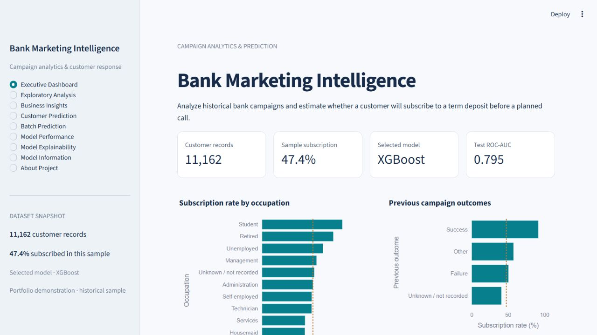

# Bank Marketing Intelligence

Analyze bank marketing campaigns and estimate term-deposit subscription with an interactive, explainable Streamlit application.

**Python · pandas · scikit-learn · XGBoost · Plotly · Streamlit**

**Held-out XGBoost results:** ROC-AUC **0.795** · Average precision **0.796** · F1 **0.720** · Recall **77.0%**. Accuracy is separately **71.7%** at the saved 37.5% classification threshold.

Explore historical patterns, inspect business insights, score individual customers or CSV batches, and review model performance and explanations. The application loads a saved pipeline; it does not retrain during use.

## Quick start

Use Python 3.14 and the pinned dependencies:

```bash
python -m venv venv
```

Activate on Windows PowerShell:

```powershell
.\venv\Scripts\Activate.ps1
```

Activate on Linux/macOS:

```bash
source venv/bin/activate
```

Then run on any platform:

```bash
python -m pip install -r requirements.txt
python -m streamlit run app.py
```

If PowerShell activation is restricted, use `.\venv\Scripts\python.exe -m streamlit run app.py` after installing with that same Python executable.

## Application preview



[Seven-screen capture guide and final review](docs/PORTFOLIO_REVIEW.md) · [Implementation details](docs/IMPLEMENTATION_REPORT.md)

## Problem and intended use

Estimate whether a customer will subscribe to a term deposit (`deposit = yes`) using customer information and planned contact details. The goal is a reproducible campaign decision-support demonstration, not an automated financial eligibility system.

Call **duration is excluded**: it is only known after the call. Contact day, month, method and campaign count must be known at scoring time. Historical end-of-campaign counts can differ from the count available at an earlier call; prospective validation is still needed.

## Dataset

The original project attributes `bank.csv` to the Bank Marketing dataset shared by **janiobachmann on Kaggle**. This repository's actual file has 11,162 rows, 16 original predictors, and one binary target. There are 5,289 subscriptions (47.38%) and 5,873 non-subscriptions. No duplicate rows or blank cells were found in the supplied raw file. Literal `unknown` categories are retained as recorded uncertainty.

This near-balanced sample should not be treated as representative of live bank conversion. Confirm the dataset's redistribution terms and provenance before publishing; the repository does not establish those rights.

## Workflow

Raw CSV → stratified 80/20 split → train-fitted outlier caps → prior-contact feature → numeric scaling and one-hot encoding → three-fold cross-validation and modest tuning → model selection → training-only threshold analysis → held-out evaluation → saved pipeline → interactive inference.

- `CampaignFeatures` learns balance 1st/99th percentile and campaign 99th percentile caps within each fit. It derives `was_contacted_previously` from `pdays != -1`.
- A `ColumnTransformer` scales numeric inputs and one-hot encodes categorical inputs.
- All preprocessing is inside the pipeline and refitted in every CV fold.
- No SMOTE or other resampling is used. The small tuning grid evaluates class weighting against unweighted alternatives.
- Predictions always load `models/pipeline.joblib`. App startup and CSV upload never retrain.
- Blank cells and invalid categories are rejected with readable messages. Categorical whitespace/case is normalized. Additional CSV columns are excluded; output row order is preserved.

## Models and actual results

The existing Logistic Regression, Random Forest and XGBoost families are preserved. A prior-probability dummy baseline is added. **XGBoost** wins by training CV average precision, not by comparing held-out test scores.

| Model | CV average precision | Test accuracy at 0.5 | Test F1 at 0.5 | Test ROC-AUC | Test average precision |
|---|---:|---:|---:|---:|---:|
| Dummy baseline | 0.474 | 0.526 | 0.000 | 0.500 | 0.474 |
| Logistic Regression | 0.763 | 0.694 | 0.637 | 0.758 | 0.760 |
| Random Forest | 0.782 | 0.731 | 0.677 | 0.786 | 0.783 |
| **XGBoost** | **0.789** | **0.745** | **0.695** | **0.795** | **0.796** |

Final XGBoost settings include 300 estimators, depth 3, learning rate 0.05, and positive-class weight 1.0. The 13 candidate configurations use three folds (39 CV fits plus refits). A fixed seed of 42 is used throughout.

The application uses a **0.375 threshold**, selected by maximum F1 on out-of-fold training predictions over 0.10–0.90 in 0.025 steps:

| Held-out metric | Value |
|---|---:|
| Accuracy | 0.717 |
| Precision | 0.676 |
| Recall | 0.770 |
| F1 | 0.720 |
| ROC-AUC | 0.795 |
| Average precision | 0.796 |

This threshold favors recall compared with 0.5; it is not optimized for financial returns or contact costs. CV tuning and threshold analysis share training folds, so their training estimates are not nested, unbiased performance estimates. The test set has 2,233 rows; no test labels select hyperparameters or threshold. The original notebook already inspected a similar split, so treat this as a reproducible holdout diagnostic rather than a fresh external benchmark.

Full results, tuning candidates, parameters, curves, dataset SHA-256, package versions, and threshold analysis live in `models/evaluation.json`. `models/test_predictions.csv` supports independent metric verification.

## Application features

| Page | What it provides |
|---|---|
| Executive Dashboard | Dataset KPIs, selected-model metric, segment and previous-outcome rates |
| Exploratory Analysis | Cohort filters, target, demographics, financial, campaign, contact, history and correlation views; data export |
| Business Insights | Computed group rates with denominators, careful interpretations, downloadable summary |
| Customer Prediction | All 15 model inputs, validated scoring, probability, class, threshold, individual sensitivity and CSV export |
| Batch Prediction | CSV example, schema, upload validation, scoring preview and full download |
| Model Performance | All model comparisons, six metrics, confusion matrix, ROC/PR curves and threshold trade-offs |
| Model Explainability | Held-out permutation importance with variability over five shuffles |
| Model Information | Pipeline, features, parameters, tuning, environment and limitations |
| About Project | Objective, dataset attribution, technology and demonstrated skills |

Global explainability uses the drop in average precision after shuffling a raw feature. Individual explanations replace one feature with its training median/mode and show the probability difference. This is **sensitivity analysis, not SHAP**; effects are not additive or causal, and replacement profiles can be unrealistic. This approach avoids an extra SHAP dependency and works across all compared estimators.

## EDA highlights

Calculated from the original uncapped dataset:

- Students: 269 subscriptions out of 360 records, **74.7%**.
- Cellular contact: 4,369 out of 8,042, **54.3%**.
- Previous successful outcome: 978 out of 1,071, **91.3%**.

These are descriptive associations. The dashboard includes denominators and comparisons to the overall sample rate. Unknown previous outcomes are not relabeled as never contacted. Monthly volume and conversion use separate charts with meaningful units.

## Installation and local run

The supplied artifacts were trained and tested with **Python 3.14.3** and the exact versions in `requirements.txt`. Use the same Python minor version and package pins for artifact compatibility. A different environment should regenerate the artifacts and rerun tests.

```powershell
# From the repository root (fresh clone)
python -m venv .venv
.\.venv\Scripts\python.exe -m pip install -r requirements.txt
.\.venv\Scripts\python.exe -m streamlit run app.py
```

On macOS/Linux, use `.venv/bin/python` in place of `.\.venv\Scripts\python.exe`.

The application opens at http://localhost:8501. The committed pipeline is ready to load; retraining is not required for ordinary use.

```powershell
# Reproduce training and regenerate current artifacts
.\.venv\Scripts\python.exe train_model.py

# Run all regression and Streamlit AppTest checks
.\.venv\Scripts\python.exe -m unittest discover -s tests -v
```

For the existing local environment, use `.\venv\Scripts\python.exe` instead. To rerun the preserved exploratory notebook, install `requirements-notebook.txt`; those optional plotting/Jupyter packages are excluded from the deployment requirements.

## Example prediction workflow

1. Open **Customer Prediction** and enter a hypothetical profile. Include the planned day, method, month and number of campaign contacts; do not provide duration.
2. Click **Predict subscription**. Read the probability alongside the documented decision threshold and model limitations.
3. Inspect the sensitivity chart and download the result. Editing fields does not change the result until you submit again.
4. For a batch, download the example from **Batch Prediction**, keep the column names, replace/add rows and upload it. Download all scored rows in their original order.

The upload limit is 5 MB / 10,000 rows. Accepted inputs are documented in the app and `src/config.py`. Scores and customer data are not written to disk or logged by the app. Lightweight console logging records startup, loading, row counts, and failures without input values.

## Structure

```text
app.py                              Streamlit application and page composition
train_model.py                      Training entry point
src/
  config.py                         Paths, feature schema and labels
  data_processing.py                Loading and shared validation
  feature_engineering.py            Train-fitted capping and prior-contact feature
  train.py                          Pipeline, CV, tuning and artifact creation
  evaluate.py                       Metrics and curve generation
  predict.py                        Trusted artifact loading and inference
  visualization.py                  Charts and computed business summaries
models/
  pipeline.joblib                   Current complete fitted pipeline
  evaluation.json                   Reproducibility and evaluation evidence
  test_predictions.csv              Held-out row indices, labels and scores
  example_customers.csv             Valid batch example
Bank_Marketing_Full_Project.ipynb    Preserved original analysis
bank.csv / bank_clean.csv           Preserved raw and legacy cleaned datasets
model.pkl / columns.pkl             Preserved legacy model artifacts (not used)
metrics.pkl / feature_importances.csv  Preserved legacy outputs (not used)
tests/                              Inference and application regression tests
docs/                               Audit, report and screenshots
.streamlit/config.toml              Theme and bounded upload configuration
.github/workflows/tests.yml         Fresh-environment CI checks
```

## Screenshots and demo

Seven real application captures:

1. [Dashboard](docs/screenshots/01-dashboard.png)
2. [Exploratory analysis](docs/screenshots/05-eda.png)
3. [Business insights](docs/screenshots/04-insights.png)
4. [Individual prediction](docs/screenshots/03-prediction.png)
5. [Batch prediction](docs/screenshots/07-batch.png)
6. [Model performance](docs/screenshots/02-performance.png)
7. [Global explainability](docs/screenshots/06-explainability.png)

See the [portfolio review](docs/PORTFOLIO_REVIEW.md) for exact inputs, expanded/collapsed sections, expected real results and an 80-second recruiter demo. All 16 automated checks pass locally; this includes all pages, prediction parity, invalid uploads and displayed-metric verification.

## Deployment

Push the reviewed repository with `models/`, `src/`, `bank.csv`, `requirements.txt` and `.streamlit/config.toml`. Configure `app.py` as the entry point and Python 3.14 to match the artifacts. Streamlit Community Cloud takes the app entry point from your GitHub repository; see the [official deployment instructions](https://docs.streamlit.io/deploy/streamlit-community-cloud/deploy-your-app/deploy) and [dependency guidance](https://docs.streamlit.io/deploy/concepts/dependencies).

If the host does not offer the trained Python/package environment, build in an available compatible environment, retrain and test there, then commit matching artifacts. Do not silently run an incompatible pickle. Only load the trusted repository model; joblib/pickle files from strangers can execute code. Public deployment and a clean Linux installation have not been performed locally; CI is provided to verify the latter.

## Limitations and next steps

- Historical, selected sample; dataset licensing and precise sampling provenance require confirmation.
- Uncalibrated probabilities, no temporal/external validation, and no causal conclusions.
- F1 threshold does not encode contact capacity, cost or expected value.
- No group fairness audit or drift monitoring. Age and demographic features require review for any operational setting.
- App is a portfolio demonstration, without authentication or an operational customer-data governance system.
- Next steps: fresh chronological validation, probability calibration, cost-sensitive policy evaluation, subgroup error analysis, and prospective campaign experiments.

## GitHub readiness

The notebook and legacy outputs are deliberately retained for provenance. `.gitignore` excludes virtual environments, Python/Jupyter caches, secrets, logs and IDE files. Before pushing, review `git diff`, verify dataset redistribution rights, choose a code license, run tests, inspect staged files for secrets/large files, and ensure the complete matching `models/` artifact set is included.
