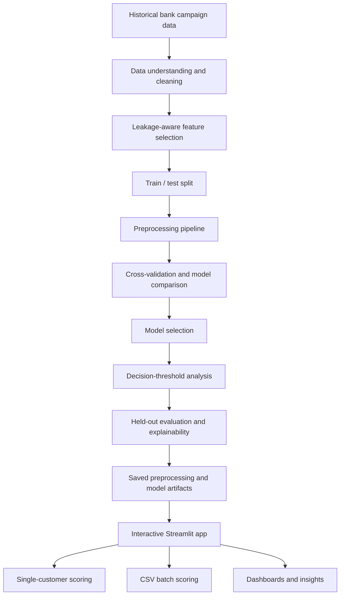

<div align="center">

# 🏦 Bank Marketing Intelligence

### Turning campaign history into actionable insights and smarter customer outreach.

**Explore the data · Understand the patterns · Predict subscription likelihood · Make informed decisions**

[](https://www.python.org/)
[](https://streamlit.io/)


### 🚀 [Launch the Live Application](https://bank-marketing-intelligence-carun64aee6xuak9rj2vmj.streamlit.app/)

</div>

---

## ✨ The idea

**What if banks could learn from previous campaigns before deciding whom to contact next?**

Marketing calls take time and resources, and contacting every customer is rarely the most efficient strategy. **Bank Marketing Intelligence** brings historical campaign analysis, machine learning predictions, and interpretable business insights into one interactive application.

This is **more than a model-training notebook**: it connects data exploration, leakage-aware feature selection, cross-validation, model comparison, decision-threshold analysis, explainability, and single or batch predictions in a Streamlit experience.

> **The goal:** Help explore which customers may be more likely to subscribe to a term deposit *before a planned marketing call*—without confusing historical associations with proven causal effects.

## 🧭 Explore the application

| Experience | What you can do |
|---|---|
| 📊 **Executive Dashboard** | See campaign activity, subscription rates, selected model information, ROC-AUC, and high-level findings. |
| 🔎 **Exploratory Data Analysis** | Filter historical data by occupation, marital status, age, and campaign characteristics. |
| 💡 **Business Insights** | Investigate patterns in occupations, contact methods, previous campaign outcomes, and customer responses. |
| 🎯 **Customer Prediction** | Enter one customer's information and estimate their subscription likelihood. |
| 📁 **Batch Prediction** | Upload a CSV, validate rows, generate probability scores, and download results. |
| 🧠 **Model Analysis** | Explore model comparisons, evaluation, explanations, and decision-threshold trade-offs. |

## ⚙️ How it works



### From historical data to predictions

1. **Understand the data:** Examine customer attributes, marketing contacts, and past subscription outcomes.
2. **Prepare responsibly:** Clean and preprocess data while avoiding features that would not be available at prediction time.
3. **Compare approaches:** Use cross-validation and model evaluation to inform model selection.
4. **Assess decisions:** Study different probability thresholds, not just one classification cutoff.
5. **Explain predictions:** Investigate the variables that influence model output.
6. **Make it usable:** Serve saved artifacts through Streamlit for individual or batch scoring—**without retraining during inference**.

## 📊 From analytics to business questions

The app is designed to help investigate questions such as:

- Which customer segments historically showed higher subscription rates?
- How does the previous campaign outcome relate to later customer response?
- How do contact methods and campaign characteristics correlate with outcomes?
- What is the trade-off between contacting more customers and focusing on higher predicted probabilities?
- Which variables contribute to an individual prediction?

> **Interpretation matters:** A pattern in historical data is an **association**, not proof that changing a marketing strategy will cause better results. Findings should guide further analysis or experiments, not be treated as causal guarantees.

## 🎯 Customer prediction

Enter customer and campaign information through the interactive interface, including:

- Age, occupation, marital status, and education
- Yearly account balance
- Credit default, housing loan, and personal loan indicators
- Contact method and campaign timing
- Previous campaign interactions

The saved machine learning pipeline processes the inputs and returns an estimated **subscription probability**. The probability is a model estimate, not a guarantee of an individual customer's decision.

## 📁 Batch scoring

For larger sets of prospective customers:

1. Upload a CSV containing customer records.
2. Validate the supplied fields and values.
3. Apply the saved preprocessing and model pipeline.
4. Generate customer-level probabilities.
5. Download the scored output.

**No model retraining happens when you request predictions.**

## 📐 Model evaluation and decision support

This project emphasizes more than overall prediction accuracy:

| Concept | Why it matters |
|---|---|
| **Cross-validation** | Provides evidence about how a candidate model performs across multiple training splits. |
| **ROC-AUC** | Evaluates how well a model ranks positive cases above negative cases across thresholds. |
| **Threshold analysis** | Makes the trade-offs of different classification cutoffs visible. |
| **Explainability** | Helps users interpret important signals behind predictions. |
| **Held-out evaluation** | Assesses selected modeling choices on data kept separate for final evaluation. |
| **Leakage-aware features** | Helps avoid relying on information unavailable before the planned call. |

**Performance metrics:** Refer to the values displayed in the application's model analysis; this README intentionally does not invent accuracy, ROC-AUC, or business-impact numbers.

## 🧰 Technology stack

| Layer | Technology / approach |
|---|---|
| Programming | **Python** |
| User interface | **Streamlit** |
| Analysis | Exploratory data analysis and business-oriented visualization |
| Modeling | Machine learning with preprocessing, comparison, and cross-validation |
| Interpretation | Model explanations and threshold trade-off analysis |
| Prediction | Saved model artifacts for single and CSV batch inference |

> This overview lists only technologies and techniques supported by the supplied project description. Add specific libraries or selected model names once confirmed from the repository.

## 🚀 Try the live app

<div align="center">

### [🌐 Open Bank Marketing Intelligence](https://bank-marketing-intelligence-carun64aee6xuak9rj2vmj.streamlit.app/)

*Explore the historical data, inspect the model, and try a customer prediction.*

</div>

## 💻 Running locally

This project uses a Streamlit interface and a previously trained prediction pipeline. To run a local copy, use the dependency file and entry point included in your repository.

```powershell
# 1. Open a terminal in the cloned project directory.

# 2. Create and activate a virtual environment.
python -m venv .venv
.\.venv\Scripts\Activate.ps1

# 3. Install dependencies (if the repository provides requirements.txt).
python -m pip install -r requirements.txt

# 4. Launch the app (if its entry point is app.py).
python -m streamlit run app.py
```

> **Check before publishing:** The exact dependency filename, application entry point, and saved-artifact paths were not included in the supplied README text. Confirm these commands against the project files and adjust if needed.

## 🔐 Responsible use and limitations

- Predictions are estimates based on historical campaign data—not guaranteed subscriptions.
- Historical patterns show **correlations**, not causal effects.
- Model quality may change when campaign practices or customer populations change.
- Customer information should be handled with appropriate privacy safeguards.
- A model should support human judgment, not replace business oversight.
- The supplied description does not establish production deployment guarantees, achieved cost savings, or a verified impact on campaign conversion rates.

## 🗺️ Possible next steps

- Compare model behavior across different customer groups and campaign periods.
- Add monitoring for data drift and changing model performance.
- Make threshold selection interactive using clearly stated business assumptions.
- Expand prediction explanations and reporting exports.
- Evaluate the application on newer, independently collected campaign data.

---

<div align="center">

### 💙 Built with curiosity for data, machine learning, and meaningful decisions

**Bank Marketing Intelligence** brings together the technical side of machine learning and the practical questions that businesses want answered.

**[Explore the live demo](https://bank-marketing-intelligence-carun64aee6xuak9rj2vmj.streamlit.app/)**

</div>
